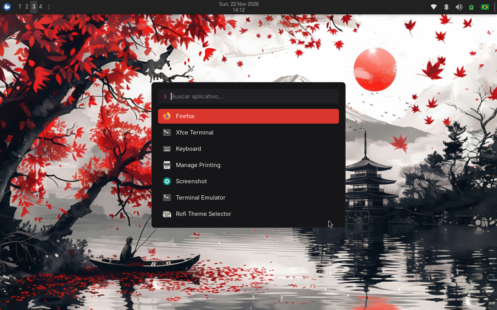

# Sumi Autumn — Rofi Theme

Tema minimalista e *flat* para o [Rofi](https://github.com/davatorium/rofi), inspirado na estética *sumi-e* — combinando fundo em preto nanquim profundo, superfície carvão, tipografia limpa e destaque cirúrgico em vermelho vermelhão.

Projetado para oferecer alto contraste, leitura rápida e baixo consumo de recursos gráficos (sem *blur* ou efeitos pesados).



## Paleta de Cores

| Função | Cor | Hex |
| :--- | :--- | :--- |
| Fundo principal (`bg`) | Preto nanquim | `#161618` |
| Superfície / Busca (`bg-alt`) | Cinza carvão | `#202024` |
| Borda (`border-col`) | Grafite sutil | `#2C2C32` |
| Texto principal (`fg`) | Branco névoa | `#ECECEC` |
| Texto secundário (`fg-muted`) | Cinza suave | `#7E828A` |
| Destaque (`accent`) | Vermelho vermelhão | `#D9362E` |

## Requisitos

* **Rofi** (testado na versão `2.0.0`)
* **Fonte:** `Inter` *(opcional, mas recomendada)*
* **Ícones:** `Papirus-Dark` *(opcional)*

## Instalação

### 1. Copie o arquivo do tema

Clone o repositório ou baixe o arquivo `sumi-autumn.rasi` e mova-o para o diretório de temas do Rofi:

```bash
mkdir -p ~/.local/share/rofi/themes
cp sumi-autumn.rasi ~/.local/share/rofi/themes/
```

### 2. Ative o tema

Você pode ativar o tema usando o seletor interativo do Rofi:

```bash
rofi-theme-selector
```

Ou adicionando a linha abaixo ao final do seu `~/.config/rofi/config.rasi`:

```css
@theme "sumi-autumn"
```

### 3. Configuração recomendada (opcional)

Para obter o visual completo com ícones `Papirus-Dark`, busca *fuzzy* e o prompt `❯`, utilize o seguinte bloco no seu `~/.config/rofi/config.rasi`:

```css
configuration {
    modi:                "drun,run,window";
    show-icons:          true;
    icon-theme:          "Papirus-Dark";
    display-drun:        "❯";
    drun-display-format: "{name}";
    matching:            "fuzzy";
    disable-history:     false;
}

@theme "sumi-autumn"
```

### 4. Teste o lançador

```bash
rofi -show drun
```

## Personalização

As principais propriedades visuais podem ser ajustadas diretamente no arquivo `sumi-autumn.rasi` sem precisar reiniciar a sessão:

* **Cores e fonte:** altere as variáveis no bloco `*` no topo do arquivo (lembre-se de manter o tamanho da fonte sincronizado no bloco `prompt`).
* **Largura da janela:** ajuste `width` dentro do bloco `window` (em pixels, como `560px`, ou porcentagem, como `45%`).
* **Altura / quantidade de itens:** altere `lines` dentro do bloco `listview`.
* **Tamanho dos ícones:** ajuste `size` dentro do bloco `element-icon`.

## Como Contribuir

Contribuições são muito bem-vindas! Se você tiver sugestões de melhorias, novas variantes (como tema claro ou destaque lateral minimalista) ou correções de compatibilidade:

1. Faça um **Fork** deste repositório.
2. Crie uma *branch* para a sua alteração:
   ```bash
   git checkout -b feat/minha-melhoria
   ```
3. Faça o *commit* das suas mudanças:
   ```bash
   git commit -m "feat: descreva sua melhoria"
   ```
4. Envie para o seu fork:
   ```bash
   git push origin feat/minha-melhoria
   ```
5. Abra um **Pull Request** descrevendo a alteração (se for uma mudança visual, inclua uma captura de tela).

Você também pode abrir uma **Issue** para relatar problemas ou propor ideias.

## Licença

Este projeto está licenciado sob a **Licença MIT** — consulte o arquivo [LICENSE](LICENSE) para mais detalhes.
